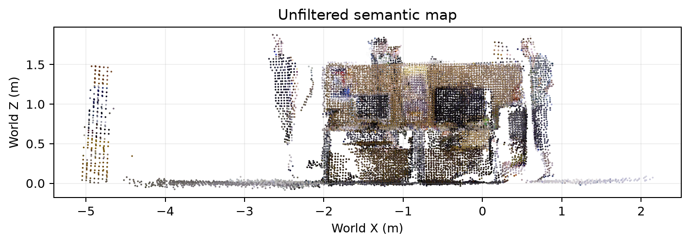
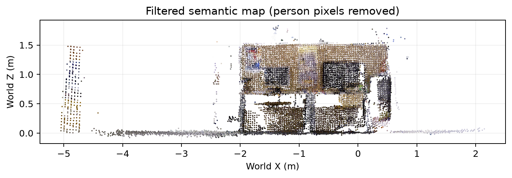

# Semantic Visual SLAM for Indoor Mobile Robot Perception

An RGB-D robotic-vision research prototype integrating ORB-SLAM3 estimated camera poses, YOLO instance segmentation, depth-based semantic mapping, and person masking. An integrated experiment has been run locally on the TUM RGB-D `freiburg3_walking_xyz` sequence. This remains a dataset-based prototype, not a validated live robot system.

## Project goals

This project explores how RGB-D perception can be used to build a simple semantic representation of an indoor environment.

The current work focuses on:

- detecting and segmenting objects in RGB frames;
- using aligned depth to estimate their 3D positions;
- transforming observations into a common world coordinate frame;
- building a semantic point-cloud representation of the scene;
- reducing dynamic-scene artifacts by filtering people from the stable map;
- comparing filtered and unfiltered reconstructions;
- preparing the system for later integration with Visual SLAM-based camera poses.

## Current project stage

The prototype has two evaluated pose sources: TUM benchmark ground truth (earlier baseline) and **ORB-SLAM3 estimated RGB-D poses (integrated locally on 2026-10-19)**. Live camera, ROS 2 simulation, physical robot deployment and dynamic-mask feedback into SLAM feature tracking have **not** been implemented.

## Pipeline

```text
RGB-D frames
   |
   +--> Object segmentation ----> semantic masks
   |
   +--> Camera poses
        TUM ground truth (benchmark baseline)
        ORB-SLAM3 estimate (integrated run)
                 |
depth + masks + camera poses
                 |
                 v
        3D back-projection
                 |
                 v
       world-frame fusion
                 |
        +--------+--------+
        |                 |
        v                 v
 stable map        semantic objects
(dynamic pixels     class + 3D
 removed)           position
        |                 |
        +--------+--------+
                 v
        qualitative + quantitative
              evaluation
```

## Tools and software used so far

| Tool / software | Current use |
| --- | --- |
| **Python** | Main implementation language for the perception and mapping pipeline |
| **Ultralytics YOLO segmentation** | Object and person detection/segmentation in RGB frames |
| **OpenCV** | RGB-D image loading, image processing, masks, and annotated detection previews |
| **NumPy** | Camera geometry, 3D back-projection, coordinate transformations, and point-cloud processing |
| **PyYAML** | Experiment and camera configuration |
| **Matplotlib** | Rendering point-cloud result previews for comparison |
| **pytest** | Unit testing for geometry, point-cloud and consistency utilities |
| **ORB-SLAM3 (C++) / Pangolin** | Estimated RGB-D camera trajectory from the TUM sequence (local WSL2 run; pinned upstream version) |
| **Git / GitHub** | Version control, experiment tracking, documentation, and project management |
| **GitHub Actions** | Reproducible testing and benchmark execution |
| **TUM RGB-D Dataset** | Current indoor RGB-D benchmark, including synchronized RGB, depth, and ground-truth camera poses |

### Simulation status

No robotics simulator has been used in the current experiments. The present stage is **dataset-based**, using the TUM RGB-D benchmark to validate the semantic perception and mapping components before moving to simulated or physical robot experiments.

## Planned tools and simulation software

| Tool / software | Planned use |
| --- | --- |
| **ROS 2** | Connect perception, camera pose, mapping, and later robot components as separate nodes |
| **Gazebo Sim** | Create a simple indoor mobile-robot simulation before physical deployment |
| **RViz2** | Visualize camera poses, point clouds, semantic observations, and robot data |
| **Intel RealSense / RealSense SDK** | Future live RGB-D experiments with a physical depth camera |
| **Mobile robot platform** | Later validation of the perception pipeline while the robot moves in an indoor environment |

These remain **optional future extensions**; they are not claimed as implemented.

## Remaining validation and optional extensions

1. Publish reproducible matched-axis map figures and a trajectory visualization.
2. Compare reconstruction quality more rigorously; person-point removal does not quantify map fidelity.
3. Improve camera pose accuracy and evaluate on additional RGB-D sequences.
4. Optional: feed dynamic masks back into the Visual SLAM tracking front-end.
5. Optional: demonstrate ROS 2, Gazebo, live RGB-D camera, or a physical robot.

## Repository layout

```text
configs/                 experiment configuration
data/                    local datasets (ignored by Git)
docs/                    milestones and experiment log
results/                 generated outputs (ignored by Git)
src/semantic_slam/       reusable Python package
tests/                   unit tests
tools/                   command-line experiment scripts
```

## Stage 1: validate semantic mapping

### 1. Create an environment

Python 3.10+ is recommended.

```bash
python -m venv .venv
```

Linux/macOS:

```bash
source .venv/bin/activate
```

Windows PowerShell:

```powershell
.venv\Scripts\Activate.ps1
```

Install:

```bash
pip install -e .
```

### 2. Add the TUM RGB-D sequence

Extract `rgbd_dataset_freiburg3_walking_xyz` under:

```text
data/rgbd_dataset_freiburg3_walking_xyz/
```

The folder should contain `rgb.txt`, `depth.txt`, `groundtruth.txt`, `rgb/`, and `depth/`.

### 3. Create RGB-depth associations

```bash
python tools/make_associations.py \
  --rgb data/rgbd_dataset_freiburg3_walking_xyz/rgb.txt \
  --depth data/rgbd_dataset_freiburg3_walking_xyz/depth.txt \
  --output data/rgbd_dataset_freiburg3_walking_xyz/associations.txt
```

### 4. Build the first semantic map with ground-truth poses

```bash
python tools/build_semantic_map.py \
  --config configs/tum_fr3_walking.yaml \
  --dataset data/rgbd_dataset_freiburg3_walking_xyz \
  --poses data/rgbd_dataset_freiburg3_walking_xyz/groundtruth.txt \
  --output results/groundtruth_map \
  --filter-dynamic
```

Expected outputs include:

```text
semantic_map.ply
object_observations.csv
frame_summary.csv
run_metadata.json
```

Run the same command without `--filter-dynamic` to create an unfiltered comparison map.

## Integrated ORB-SLAM3 + YOLO experiment (2026-10-19 local WSL2 run)

The RGB-D ORB-SLAM3 example produced `CameraTrajectory.txt` and `KeyFrameTrajectory.txt` on TUM `freiburg3_walking_xyz`. Python mapping then used the estimated `CameraTrajectory.txt` rather than ground-truth poses. The local experiment used YOLO segmentation, back-projected RGB-D geometry, and the same estimated camera poses to construct the unfiltered and person-filtered maps.

**Trajectory evaluation:** 826 matched poses after timestamp matching; rigidly aligned ATE RMSE **0.583068 m** (mean 0.512931 m, median 0.447341 m, maximum 1.178976 m). This is a functioning estimated-pose baseline, but it is **not** evidence of precise indoor localization.

| Estimated-pose experiment (frame step 15) | Unfiltered | Person-filtered |
| --- | ---: | ---: |
| Processed frames | 56 | 56 |
| Semantic detection observations | 328 | 328 |
| Raw 3D points | 251,323 | 181,231 |
| Voxel-downsampled map points | 119,869 | 94,213 |

Both runs include 73 person observations and 255 static-class observations. Person masking excluded **70,092 raw sampled points (27.89%)**. These are repeated detections, **not unique objects**. Point reduction alone does not establish a gain in map accuracy or SLAM localization stability.

**Preliminary viewpoint-consistency experiment:** same-class spatial clustering (0.6 m radius, minimum 3 observations per reported cluster) grouped **244 of 255 static observations into 13 repeated clusters**, with a **0.206231 m observation-weighted mean distance to cluster centroid**. Clusters are **not verified physical-object identities**; the metric depends on cluster thresholds and pose accuracy.

These results were observed in a **local Windows 11 / Ubuntu 22.04 WSL2 run**. Large PLY outputs, weight files, trajectories and final figures remain on the local machine; GitHub Actions validation and public upload of final figures are separate steps.

**Reproduce semantic mapping after creating the ORB-SLAM3 trajectory** (from the repository root with the TUM dataset downloaded):

```bash
python tools/build_semantic_map.py \
  --config configs/tum_fr3_walking.yaml \
  --dataset ~/slam_data/rgbd_dataset_freiburg3_walking_xyz \
  --poses ~/slam_data/orbslam3_results/CameraTrajectory.txt \
  --output ~/slam_data/orbslam3_results/final_filtered \
  --frame-step 15 --filter-dynamic
python tools/analyze_viewpoint_consistency.py \
  --observations ~/slam_data/orbslam3_results/final_filtered/object_observations.csv \
  --output-json ~/slam_data/orbslam3_results/viewpoint_consistency.json
```

## Earlier ground-truth-pose benchmark result

A stronger filtered-vs-unfiltered experiment has been completed on the TUM RGB-D `freiburg3_walking_xyz` sequence using TUM ground-truth poses and a frame step of 15.

| Metric | Unfiltered | Person-filtered |
| --- | ---: | ---: |
| Processed frames | 55 | 55 |
| Semantic object observations | 319 | 319 |
| Raw map points | 245,914 | 177,824 |
| Voxel-downsampled points | 69,527 | 44,550 |

The current run produced **319 semantic observations** across the sampled frames, including **71 person observations** and **248 static-object observations**, with a mean detection confidence of approximately **0.714**.

Dynamic-person filtering removed **68,090 raw 3D points (27.69%)** from the sampled reconstruction while keeping the semantic observation records available for analysis.

### Unfiltered semantic map



### Person-filtered semantic map



The figures above depict the **earlier benchmark-pose baseline**. They do **not** depict the 2026-10-19 estimated-pose experiment. The locally generated estimated-pose figures are currently pending upload to `docs/images/`: `unfiltered_matched.png`, `filtered_matched.png`, and `trajectory_comparison.png`. For a fair local estimated-pose comparison, use fixed World X and Z axis limits:

```bash
python tools/render_map_preview.py --input ~/slam_data/orbslam3_results/final_unfiltered/semantic_map.ply --output ~/slam_data/orbslam3_results/unfiltered_matched.png --title 'ORB-SLAM3 Unfiltered Map' --xlim -5 5 --zlim 0 6
python tools/render_map_preview.py --input ~/slam_data/orbslam3_results/final_filtered/semantic_map.ply --output ~/slam_data/orbslam3_results/filtered_matched.png --title 'ORB-SLAM3 Person-Filtered Map' --xlim -5 5 --zlim 0 6
```

The full maps, CSV observations, and raw trajectory files remain local. Machine-readable summaries for the measured local ORB-SLAM3 experiments are committed under [`docs/results/`](docs/results/). The three final estimated-pose PNGs and the demonstration MP4 are not yet uploaded.

## Current evidence

- locally compiled and executed ORB-SLAM3 RGB-D trajectory estimation;
- trajectory metrics and a separate BGR configuration sensitivity summary in `docs/results/`;
- locally generated, matched-scale estimated-pose map comparisons and trajectory visualization (PNG upload still pending);
- preliminary viewpoint-consistency metrics in `docs/results/viewpoint_consistency_summary.json`;
- synchronized RGB-D benchmark processing;
- YOLO object/person segmentation;
- depth-based 3D object localization;
- semantic point-cloud generation;
- filtered vs. unfiltered reconstruction comparison;
- semantic observation statistics;
- annotated detection previews;
- reproducible benchmark workflow.

See `docs/milestones.md` for the implementation roadmap and the separation between current work and future extensions.
